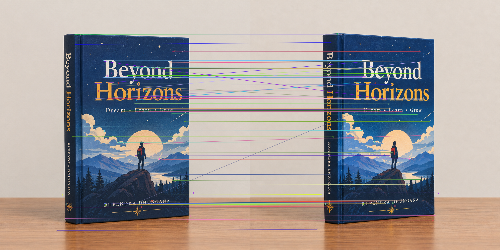
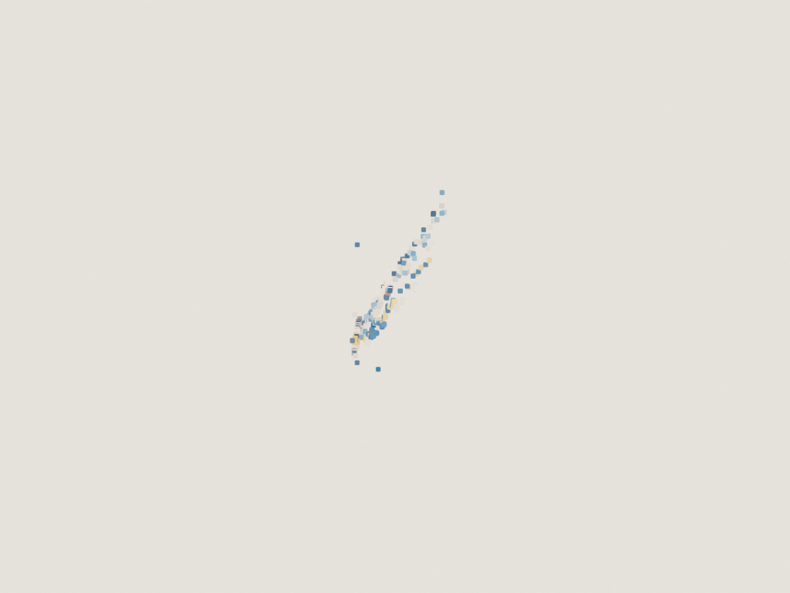

# View3D: Sparse 3D Reconstruction from Two Images

## Executive summary

This project demonstrates a compact computer vision pipeline for estimating a sparse 3D point cloud from two images of the same object captured from slightly different viewpoints. The workflow is intentionally educational and lightweight: it uses classical multi-view geometry rather than a deep learning model, and it relies on OpenCV for feature detection, matching, epipolar geometry, and triangulation.

The end goal is to recover the relative camera pose between two views and reconstruct a set of 3D points that approximate the object surface. The output is saved as a colored `.ply` point cloud, which can be opened in tools such as MeshLab or CloudCompare for inspection.

---

## 1. Background

Reconstructing 3D geometry from 2D images is one of the central problems in computer vision. In many real-world applications—robotics, 3D scanning, autonomous navigation, photogrammetry, and AR/VR—systems must infer structure from observations taken at different viewpoints. The challenge is that a single image contains no direct depth information; depth must be inferred by comparing multiple views of the same scene.

This project addresses a narrow but fundamental case: two calibrated or approximately calibrated cameras observing the same rigid object from different positions. The object used here is a hardcover book, which presents a textured, non-planar surface and is well-suited for feature-based 3D reconstruction.

The problem is solved in a step-by-step manner:

1. Load both views of the object.
2. Detect distinctive image features using SIFT.
3. Match the same physical features across the two views.
4. Estimate the relative camera motion using the essential matrix.
5. Recover 3D points by triangulating matched pixels.
6. Filter unstable points and export the result as a point cloud.

This project is a good example of a classic structure-from-motion / stereo pipeline reduced to a minimal form. It is simple enough to understand and run, while still embodying the core geometric ideas behind real 3D reconstruction systems.

---

## 2. Project objective

The specific objective of this repository is to estimate a sparse 3D model from a pair of images and to save it as a file that can be visualized in common 3D software. The project is deliberately designed around the following assumptions:

- The same object appears in both images.
- The object is rigid and does not deform between views.
- The camera motion is small but non-zero.
- The images are similar in size and share the same scene content.
- The camera intrinsics are unknown and approximated using a simple focal-length assumption.

Because the project uses only two images, the recovered depth is relative rather than metric. In other words, the point cloud is reconstructed up to an arbitrary scale factor. This is typical in structure-from-motion: a two-view system can recover the shape and motion up to scale unless a known physical distance or calibration is provided.

---

## 3. Methodology

### 3.1 System overview

The pipeline is implemented as a sequence of independent Python scripts under the [src/](src) folder. Each script performs a specific stage and produces intermediate evidence that can be inspected visually.


### 3.2 Data acquisition and image loading

The project expects two images placed in the [photo/](photo) directory:

- [photo/view1.jpg](photo/view1.jpg)
- [photo/view2.jpg](photo/view2.jpg)

The loader script validates that both images exist and have identical dimensions before processing. This is an important prerequisite because every matched feature must be interpreted in the same coordinate system across both views.

The code is implemented in [src/load_images.py](src/load_images.py), which loads the images with OpenCV and displays them side by side for simple visual inspection.

### 3.3 Feature detection with SIFT

The first computational stage is detecting salient image features. The implementation uses OpenCV's SIFT (`cv2.SIFT_create()`), which finds keypoints that are stable under scale, rotation, and local appearance changes.

SIFT is suitable for this problem because the two views are taken from different perspectives but depict the same object. Distinctive points such as corners, edges, and textured regions are identified in each image independently. Around each keypoint, a descriptor is computed, which describes the local visual pattern as a numerical vector.

This process occurs in [src/detect_features.py](src/detect_features.py). The script prints how many keypoints were detected and overlays them on the images for visual inspection.

### 3.4 Feature matching and Lowe's ratio test

Once the keypoints and descriptors are extracted, the next step is to match features between the two images. The project uses `cv2.BFMatcher` with L2 distance and obtains the two nearest neighbors for each descriptor in the first image.

A candidate match is accepted only if it is much better than the second-best option, using Lowe's ratio test. This reduces false matches that arise from repeated or ambiguous textures. The formulation is:

- if `best_distance < 0.75 * second_best_distance`, keep the match
- otherwise reject it

This is a standard and effective method for generating high-confidence correspondences in multi-view matching pipelines.

The matching stage is implemented in [src/match_features.py](src/match_features.py), and the outputs include a preview image saved as [images/matches.png](images/matches.png).

### 3.5 Epipolar geometry and pose estimation

The project then models the transformation between cameras using epipolar geometry. For two views of a rigid scene, the relative motion is captured by the essential matrix `E`, which relates corresponding points across the images:

- `x2^T E x1 = 0`

where `x1` and `x2` are homogeneous coordinates of matched points in the two images.

Because the system does not know the exact camera intrinsics, it assumes a simple pinhole approximation with a focal length equal to the image width and a principal point at the image center. This is not a full calibration, but it is enough for a minimal demonstration.

The essential matrix is estimated using `cv2.findEssentialMat` with RANSAC. RANSAC removes outliers that do not fit the shared camera-motion geometry, which is crucial because feature matching produces a significant number of false correspondences.

Then `cv2.recoverPose` recovers the relative rotation `R` and translation direction `t` from the essential matrix. The translation is only known up to scale, as expected from a two-view setup. The output includes the estimated rotation matrix, rotation angle, and translation vector.

This stage is implemented in [src/estimate_pose.py](src/estimate_pose.py).

### 3.6 Triangulation and 3D point recovery

Once the relative camera pose is known, corresponding pixels can be projected back into 3D space via triangulation. The code constructs two camera projection matrices:

- camera 1 at the origin
- camera 2 translated and rotated relative to camera 1

OpenCV's `cv2.triangulatePoints` computes homogeneous 3D points from the matched image coordinates. These are then converted to Cartesian coordinates by dividing by the homogeneous `w` term.

However, not every triangulated point is valid. The project filters points using a series of geometric checks:

- point must be in front of both cameras
- point must have finite coordinates
- point must pass a reprojection-error threshold
- point must be consistent with the observed matches

This is a standard quality-control step in 3D reconstruction and is essential for producing a stable sparse model.

The triangulation and filtering logic is implemented in [src/triangulate_points.py](src/triangulate_points.py), and the output is exported as [point_cloud.ply](point_cloud.ply).

### 3.7 PLY export and color assignment

The final 3D point set is saved in the ASCII PLY format, which is widely compatible with 3D viewers. Each reconstructed point stores:

- `x`, `y`, `z`
- `red`, `green`, `blue`

The color is sampled from the corresponding pixel in the first image, so the resulting point cloud retains some texture information and is far easier to interpret visually than a grayscale cloud.

Importantly, this output is not a filled 3D mesh. It is a sparse point cloud: one 3D point per reliable matched feature. This is exactly what the project is designed to produce from two views.

---

## 4. Visuals and sample outputs

### 4.1 Input views

The project uses a pair of object views taken from slightly different angles. These are the raw inputs.


### 4.2 Feature detection output

SIFT identifies many distinct points in each image. These points are then visualized as circles with scale and orientation cues.

The full feature-detection output is created by [src/detect_features.py](src/detect_features.py), and the visualization is useful for verifying that the scene contains enough texture for reconstruction.

### 4.3 Match preview

The most important intermediate output is the feature correspondence preview. This image shows which keypoints were matched across the two views and how many survived the Lowe-ratio test.



This stage is critical because if the matching quality is poor, the geometry and triangulation stages will fail or produce noisy 3D points.

### 4.4 Geometry-checked inlier matches

The pose-estimation script also saves a refined match view that contains only those correspondences that remain after RANSAC and the pose-check filter. This reveals how much of the original feature matching is consistent with a coherent two-view geometry.

The output image is generated by [src/estimate_pose.py](src/estimate_pose.py) via `pose_inliers.png` when the script is run in a local environment.

### 4.5 3D output

The final sparse model is exported as a `.ply` point cloud. A representative output is available at [point_cloud.ply](point_cloud.ply), and a more coarse model is also present at [rough_model.ply](rough_model.ply).

A rendered visualization of the reconstructed point cloud is also generated by the helper script [point_cloud_visualizer.py](point_cloud_visualizer.py). This script opens the PLY file, renders the sparse 3D points with color, and saves a PNG preview.



These files can be inspected in viewers such as:

- MeshLab
- CloudCompare
- Blender
- custom Open3D visualization scripts

This is still a sparse cloud rather than a closed object surface; each visible point corresponds to a matched visual feature and not to every point on the book surface.

---

## 5. Results and discussion

This project successfully demonstrates a minimal, classical 3D reconstruction pipeline. The key strengths of the method are:

- clear geometric interpretation
- straightforward implementation using OpenCV
- effective use of SIFT and RANSAC
- useful intermediate visualization at each stage
- easy portability and minimal dependencies

The main limitations are also important to understand:

- the system assumes approximate intrinsics rather than calibrated camera parameters
- the translation is recovered only up to scale
- reconstruction is sparse rather than dense
- the resulting model depends on the quality of the feature matches
- the method is sensitive to weak texture, repetitive patterns, and motion blur

In real photogrammetry pipelines, these limitations are usually addressed by using more robust feature descriptors, bundle adjustment, camera calibration, more than two views, and dense reconstruction methods. However, for a small educational project, this approach is both valid and easy to interpret.

---

## 6. Repository structure

```text
View3D/
├── photo/
│   ├── view1.jpg
│   └── view2.jpg
├── src/
│   ├── detect_features.py
│   ├── estimate_pose.py
│   ├── load_images.py
│   ├── match_features.py
│   ├── poisson_reconstruction.mlx
│   └── triangulate_points.py
├── images/
│   ├── matches.png
│   └── point_cloud_visualized.png
├── point_cloud.ply
├── point_cloud_visualizer.py
├── rough_model.ply
├── requirements.txt
├── note.txt
├── .gitignore
└── README.md
```

---

## 7. Setup and usage

### Install dependencies

```bash
python -m venv .venv
source .venv/bin/activate
pip install -r requirements.txt
```

The repository currently includes:

- `opencv-python`
- `numpy`
- `open3d` for optional 3D visualization

### Run the pipeline

```bash
python src/load_images.py
python src/detect_features.py
python src/match_features.py --no-display
python src/estimate_pose.py --no-display
python src/triangulate_points.py
```

### Render the point cloud in 3D

```bash
python point_cloud_visualizer.py --output images/point_cloud_visualized.png
```

This script loads [point_cloud.ply](point_cloud.ply), renders the sparse 3D point cloud, and saves it as a PNG preview. The output can also be opened interactively with `--show`.

### Expected outputs

- `matches.png` in the project root or generated through the repo workflow
- `point_cloud.ply` containing the reconstructed 3D points
- `images/point_cloud_visualized.png` showing the point cloud in 3D
- `pose_inliers.png` if the pose-estimation visualization is generated locally

---

## 8. Why this project matters

This project captures a classic principle in modern vision: if the same 3D world is observed from multiple viewpoints, the relative motion and geometry can be inferred from image correspondences alone. That principle underlies everything from stereo cameras to large-scale 3D mapping systems.

Even in its simplified form, this project demonstrates the central ideas behind:

- 3D perception
- multi-view geometry
- visual SLAM
- structure from motion
- photogrammetry
- sparse reconstruction pipelines

It is a useful foundation for anyone learning how raw camera images become a 3D scene representation.

---

## 9. References and further reading

- OpenCV documentation: Feature detection and matching
- Lowe, D. G. (2004). Distinctive Image Features from Scale-Invariant Keypoints
- Hartley and Zisserman, Multiple View Geometry in Computer Vision
- Standard epipolar geometry and triangulation workflows used in modern photogrammetry and SLAM systems

---

## 10. Conclusion

View3D provides a compact, understandable, and visually grounded implementation of sparse 3D reconstruction from two image views. It captures the essence of geometric computer vision: detect stable features, match them across views, estimate motion, triangulate structure, and save the result as a 3D point cloud.

The repository is small enough for educational use, but rich enough to illustrate the core mathematical and engineering ideas used in real 3D vision systems.
